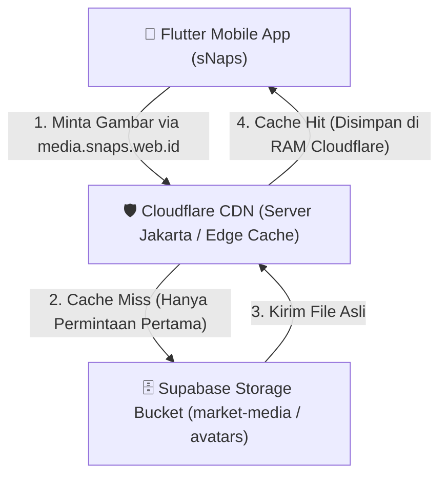

# Panduan Masa Depan: Integrasi Cloudflare CDN untuk Optimasi Media sNaps

Dokumen panduan ini menjelaskan cara mengaktifkan Cloudflare Content Delivery Network (CDN) sebagai lapisan penyangga (*cache proxy*) di depan Supabase Storage. Tujuannya adalah mempercepat *loading* feed aplikasi dan menghemat kuota *egress bandwidth* gratis Supabase.

---

## 1. Mengapa Cloudflare CDN Dibutuhkan?

1. **Memangkas Latensi Jaringan (2x – 4x Lebih Cepat)**:
   - Gambar tidak lagi dijemput dari server Supabase di Tokyo/Singapura, melainkan langsung disajikan dari server *Edge* Cloudflare terdekat (Jakarta/Semarang).
2. **Hemat Kuota Bandwidth Supabase Hingga 90%**:
   - Supabase Free Plan memiliki batas unduh data (*bandwidth*) 5 GB per bulan.
   - Dengan Cloudflare, gambar hanya diambil satu kali dari Supabase, kemudian didistribusikan ke ribuan siswa secara gratis tanpa batas kuota.
3. **Pemuatan Gambar Paralel Mulus**:
   - Menghindari efek *image loading lag* atau kotak abu-abu kosong saat siswa melakukan *fast scrolling* pada feed beranda.

---

## 2. Arsitektur Alur Data



---

## 3. Langkah-Langkah Konfigurasi (Saat Ingin Diaktifkan)

### Langkah A: Daftarkan Subdomain di DNS Cloudflare
1. Buka dashboard Cloudflare untuk domain `snaps.web.id`.
2. Masuk ke menu **DNS** $\rightarrow$ **Records** $\rightarrow$ **Add record**:
   - **Type**: `CNAME`
   - **Name**: `media` (menghasilkan URL `media.snaps.web.id`)
   - **Target**: `<project-ref>.supabase.co` (contoh: `lcwsxldnoqjdfqxqcqja.supabase.co`)
   - **Proxy status**: **Proxied** (ikon awan oranye menyala).
   - **TTL**: Auto.
3. Klik **Save**.

---

### Langkah B: Atur Cache Rules di Cloudflare
Agar Cloudflare menyimpan gambar dalam jangka waktu lama:
1. Masuk ke menu **Caching** $\rightarrow$ **Cache Rules** $\rightarrow$ **Create rule**.
2. Beri nama: `Cache Supabase Images`.
3. Pada bagian **When incoming requests match**:
   - Pilih: `Hostname equals media.snaps.web.id`
4. Pada bagian **Cache eligibility**:
   - Pilih: **Eligible for cache**.
5. Pada bagian **Edge TTL**:
   - Pilih: **Override origin** $\rightarrow$ Atur waktu: **30 days** (atau 1 month).
6. Pada bagian **Browser TTL**:
   - Atur waktu: **7 days**.
7. Klik **Deploy**.

---

### Langkah C: Helper URL Gambar di Flutter (`lib/core/utils/image_url_helper.dart`)

Buat fungsi pembantu sederhana di codebase Flutter agar link gambar dari database otomatis menggunakan domain Cloudflare CDN:

```dart
class ImageUrlHelper {
  // Ubah ke true jika Cloudflare sudah aktif
  static const bool useCdn = true;
  static const String cdnBaseUrl = 'https://media.snaps.web.id/storage/v1/object/public';
  static const String supabaseBaseUrl = 'https://lcwsxldnoqjdfqxqcqja.supabase.co/storage/v1/object/public';

  /// Mengonversi URL mentah Supabase menjadi URL Cloudflare CDN yang terakselerasi
  static String getCdnUrl(String? originalUrl) {
    if (originalUrl == null || originalUrl.isEmpty) {
      return '';
    }
    if (!useCdn) {
      return originalUrl;
    }
    if (originalUrl.startsWith(supabaseBaseUrl)) {
      return originalUrl.replaceFirst(supabaseBaseUrl, cdnBaseUrl);
    }
    return originalUrl;
  }
}
```

---

## 4. Cara Pengujian & Verifikasi

Setelah konfigurasi aktif, uji melalui terminal menggunakan perintah `curl`:

```bash
curl -I https://media.snaps.web.id/storage/v1/object/public/market-media/<nama-file.jpg>
```

Periksa bagian header respon:
- **`cf-cache-status: MISS`**: Permintaan pertama (gambar baru diambil dari Supabase).
- **`cf-cache-status: HIT`**: Permintaan kedua dan seterusnya (gambar diambil instan dari server lokal Cloudflare tanpa memotong kuota Supabase).

---

## 5. Checklist Kesiapan
- [ ] Subdomain `media.snaps.web.id` terdaftar dengan status Proxied (awan oranye).
- [ ] Aturan Cache Rules 30 hari sudah aktif.
- [ ] File gambar diuji dan menghasilkan header `cf-cache-status: HIT`.
- [ ] Helper `ImageUrlHelper` diaktifkan di aplikasi Flutter.
