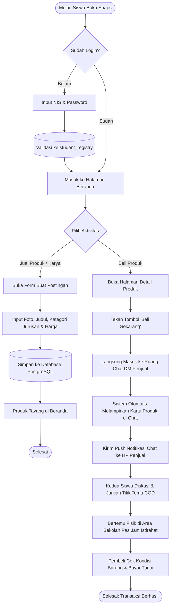

# 03. DIAGRAM FLOWCHART SISTEM DIGITAL (sNAPS)

**Dokumen**: Bab III - Bagian 3.2.2  
**Proyek**: Snapan Market Mobile (sNaps) - SMKN 8 Semarang  
**Fokus**: Pemetaan Logika Terotomatisasi Platform Mobile sNaps  

---

## 1. Definisi & Konsep Alur Sistem Digital
Alur sistem digital memodelkan bagaimana instruksi komputasi berjalan di aplikasi mobile sNaps, mulai dari validasi akun berbasis NIS, pemilihan katalog karya, pemilihan titik temu sekolah (*School Meeting Points*), pengecekan stok atomik di database PostgreSQL Supabase, hingga penerbitan bukti pesanan digital.

---

## 2. Diagram Flowchart Sistem

---

## 3. Penjelasan Tahapan Krusial Sistem

1. **Autentikasi Siswa Berbasis NIS**:
   Aplikasi memastikan setiap pengguna adalah siswa aktif SMKN 8 Semarang dengan memeriksa identitas ke database `student_registry`.
2. **Publikasi Karya Fleksibel (Tanpa Beban Stok)**:
   Siswa dapat mempublikasikan karya vokasi atau barang preloved dengan mengisi foto, deskripsi, kategori jurusan, dan harga secara instan.
3. **Pemesanan Instan Langsung ke Chat DM (*Direct-to-DM Flow*)**:
   Ketika pembeli menekan tombol 'Beli Sekarang', sistem langsung menghubungkan pembeli ke ruang obrolan pribadi (*Direct Message*) penjual dengan otomatis melampirkan kartu ringkasan produk.
4. **Kesepakatan Titik Temu COD & Transaksi Tunai**:
   Kedua siswa menyepakati titik kumpul sekolah (seperti Gazebo PPLG, Kantin, atau Lobby) secara langsung lewat percakapan chat, kemudian bertemu fisik saat jam istirahat untuk serah terima barang dan pembayaran tunai.
