# 03. DIAGRAM FLOWCHART SISTEM DIGITAL (sNAPS)

**Dokumen**: Bab III - Bagian 3.2.2  
**Proyek**: Snapan Market Mobile (sNaps) - SMKN 8 Semarang  
**Fokus**: Pemetaan Logika Terotomatisasi Platform Mobile sNaps  

---

## 1. Definisi & Konsep Alur Sistem Digital
Alur sistem digital memodelkan bagaimana instruksi komputasi berjalan di aplikasi mobile sNaps, mulai dari validasi akun berbasis NIS, pemilihan katalog karya, pemilihan titik temu sekolah (*School Meeting Points*), pengecekan stok atomik di database PostgreSQL Supabase, hingga penerbitan bukti pesanan digital.

---

## 2. Diagram Flowchart Sistem

```mermaid
flowchart TD
    Start([Mulai: Siswa Membuka Aplikasi sNaps]) --> CheckAuth{Apakah Token Sesi Login Aktif?}
    CheckAuth -- Tidak --> InputNIS[Input NIS & Password Siswa]
    InputNIS --> ValidateRegistry[(Validasi ke Tabel student_registry)]
    ValidateRegistry --> CheckNISValid{Apakah NIS Terdaftar & Aktif?}
    CheckNISValid -- Tidak --> ShowAlertAuth[Tampilkan Peringatan: 'NIS Tidak Terdaftar di SMKN 8'] --> InputNIS
    CheckNISValid -- Ya --> CreateSession[Terbitkan Sesi JWT & Muat Profil Siswa]
    
    CheckAuth -- Ya --> LoadHome[Buka Layar Beranda: Feed Komunitas & Marketplace]
    CreateSession --> LoadHome

    LoadHome --> UserNavChoice{Pilih Aktivitas Siswa}

    %% JALUR PENJUAL
    UserNavChoice -- Jual Produk / Unjuk Karya --> OpenCreatePost[Buka Formulir Pembuatan Listing Produk]
    OpenCreatePost --> FillProductData[Input Judul, Deskripsi, Kategori Jurusan, Foto, Harga, Stok]
    FillProductData --> ValidateInput{Validasi Input Lengkap?}
    ValidateInput -- Tidak --> ShowErrorForm[Tampilkan Pesan Error Validasi Form] --> FillProductData
    ValidateInput -- Ya --> InsertProductDB[(Simpan Record Baru ke Tabel market_posts)]
    InsertProductDB --> PostBroadcast[Produk Tayang Secara Publik di Feed] --> EndSellerWait([Selesai: Menunggu Pembeli])

    %% JALUR PEMBELI
    UserNavChoice -- Beli Produk Vokasi --> BrowseMarket[Jelajah Katalog & Filter Kategori: PPLG / DKV / Kuliner]
    BrowseMarket --> OpenDetail[Buka Halaman Detail Produk & Profil Penjual]
    OpenDetail --> CheckAvailableStock{Cek Database: Apakah Stok > 0?}
    CheckAvailableStock -- Habis (0) --> ShowEmptyState[Tombol Beli Dinonaktifkan: 'Stok Habis'] --> BrowseMarket
    CheckAvailableStock -- Tersedia --> TapBuy[Tekan Tombol 'Beli Sekarang']
    
    TapBuy --> OpenCheckoutSheet[Sistem Membuka Lembar Checkout COD]
    OpenCheckoutSheet --> LoadMeetingPoints[(Query Daftar Spot dari school_meeting_points)]
    LoadMeetingPoints --> SelectPoint[Pembeli Memilih Titik Temu via Dropdown / List: Gazebo / Kantin / Lab]
    SelectPoint --> InputBuyerNote[Pembeli Menulis Catatan Jam Pertemuan COD]
    InputBuyerNote --> TapConfirmOrder[Tekan 'Konfirmasi Pesanan']

    TapConfirmOrder --> ConnectDirectChat[(Sistem Menghubungkan ke Percakapan: conversations & direct_messages)]
    ConnectDirectChat --> SendAutoChatMsg[Sistem Mengirim Pesan Otomatis: Ringkasan Produk, Harga & Titik Temu COD]
    SendAutoChatMsg --> TriggerPushNotif[Kirim Push Notifikasi Pesan Masuk ke HP Siswa Penjual]
    TriggerPushNotif --> ShowSuccessModal[Tampilkan Modal Sukses Pesanan & Tombol 'Buka Obrolan']
    
    ShowSuccessModal --> OpenChatRoom[Buka Ruang Obrolan: Siswa Saling Mengonfirmasi Janjian COD]
    OpenChatRoom --> MeetPhysicalCOD[Kedua Siswa Bertemu di Titik Temu Sekolah Sesuai Janjian]
    MeetPhysicalCOD --> CompleteVerification[Pembeli Memeriksa Fisik Barang & Membayar Tunai]
    CompleteVerification --> EndFinish([Selesai: Transaksi COD Berhasil])
```

---

## 3. Penjelasan Tahapan Krusial Sistem

1. **Validasi Akun Siswa Terpadu**:
   Aplikasi memverifikasi identitas siswa terhadap database buku induk `student_registry` SMKN 8 Semarang dan menghubungkannya dengan profil autentikasi akun.
2. **Standarisasi Lokasi Titik Temu (*School Meeting Points*)**:
   Sistem menyajikan pilihan titik kumpul resmi sekolah melalui *dropdown / list selector* (seperti Gazebo PPLG, Kantin, Lobby) tanpa memerlukan peta denah 2D yang berat di perangkat siswa.
3. **Koordinasi Otomatis via Direct Messaging**:
   Setelah konfirmasi pesanan, sistem secara otomatis menerbitkan konteks transaksi ke ruang obrolan (*Direct Message*) penjual dengan format pesan rapi yang mencantumkan nama produk, harga, dan titik temu COD terpilih.
4. **Verifikasi Transaksi Tunai Mandiri**:
   Penyelesaian transaksi dilakukan langsung saat kedua siswa bertemu fisik di lokasi sekolah dengan memeriksa kondisi barang dan penyerahan uang tunai secara aman.
