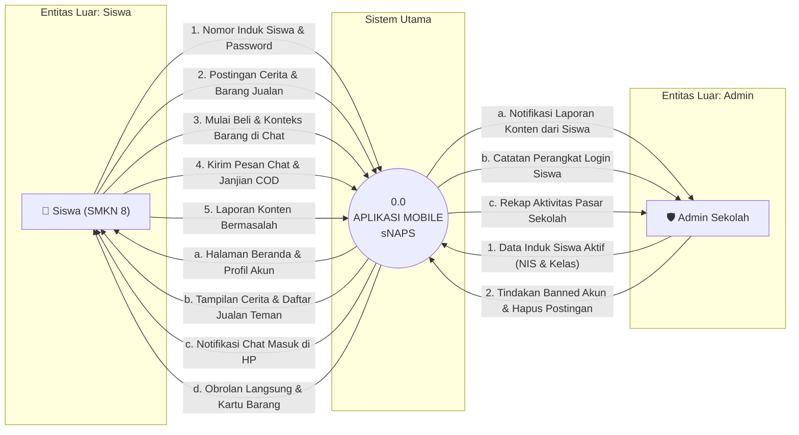

# 04. DIAGRAM KONTEKS (CONTEXT DIAGRAM)

**Dokumen**: Bab III - Bagian 3.3  
**Proyek**: Snapan Market Mobile (sNaps) - SMKN 8 Semarang  
**Fokus**: Pemodelan Tingkat Tertinggi Batasan Sistem dan Entitas Eksternal  

---

## 1. Definisi & Fungsi Diagram Konteks
Diagram Konteks (sering disebut sebagai DFD Level 0 Global) merupakan representasi model proses tingkat tertinggi yang mengisolasi sistem perangkat lunak secara keseluruhan sebagai satu lingkaran proses tunggal (*Proses 0.0*) dan memetakan interaksi aliran data dua arah dengan entitas lingkungan luar (*External Entities / Terminators*).

---

## 2. Diagram Konteks Sistem sNaps

---

## 3. Identifikasi Entitas Eksternal

### 3.1 Entitas Siswa
- **Peran**: Siswa aktif SMKN 8 Semarang. Bisa cerita, posting jualan, beli barang teman via chat DM, dan janjian ketemuan COD di area sekolah.

### 3.2 Entitas Admin Sekolah
- **Peran**: Pengelola sekolah (Kesiswaan / Tim IT) yang menyediakan daftar NIS resmi siswa aktif agar orang luar tidak bisa daftar, serta menangani laporan postingan tidak pantas.

---

## 4. Tabel Rincian Aliran Data Masuk & Keluar

| ID Aliran | Nama Aliran Data | Arah Aliran | Elemen Atribut Data |
|---|---|---|---|
| **IN-01** | Kredensial Login NIS | Siswa ➔ Sistem | `nis`, `password`, `device_id`, `device_model` |
| **IN-02** | Data Produk Vokasi | Siswa ➔ Sistem | `seller_id`, `title`, `description`, `price`, `stock`, `category`, `image_urls` |
| **IN-03** | Data Pesanan COD | Siswa ➔ Sistem | `buyer_id`, `post_id`, `meeting_point_id`, `buyer_note` |
| **IN-04** | Master Registry Siswa | Admin ➔ Sistem | `nis`, `full_name`, `class_group`, `major`, `is_active` |
| **IN-05** | Master Titik Temu COD | Admin ➔ Sistem | `code`, `name`, `area_zone`, `description`, `photo_url` |
| **OUT-01** | Notifikasi Pesanan COD | Sistem ➔ Siswa | `order_id`, `product_title`, `buyer_name`, `meeting_point_name`, `buyer_note` |
| **OUT-02** | Laporan Konten Siswa | Sistem ➔ Admin | `report_id`, `reporter_nis`, `post_id`, `reason`, `timestamp` |
