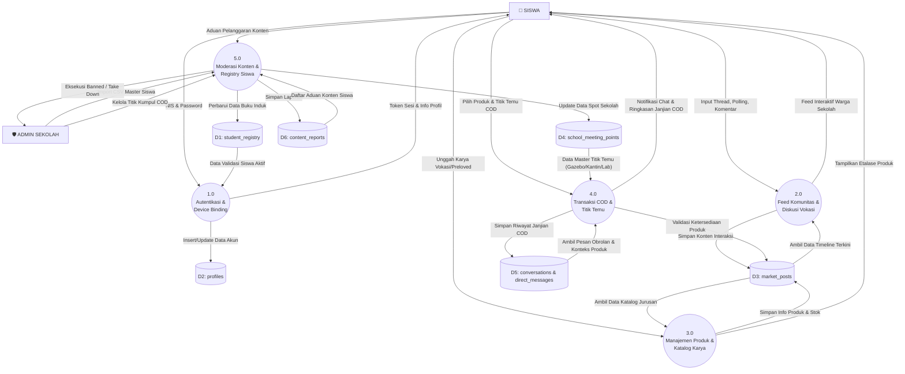
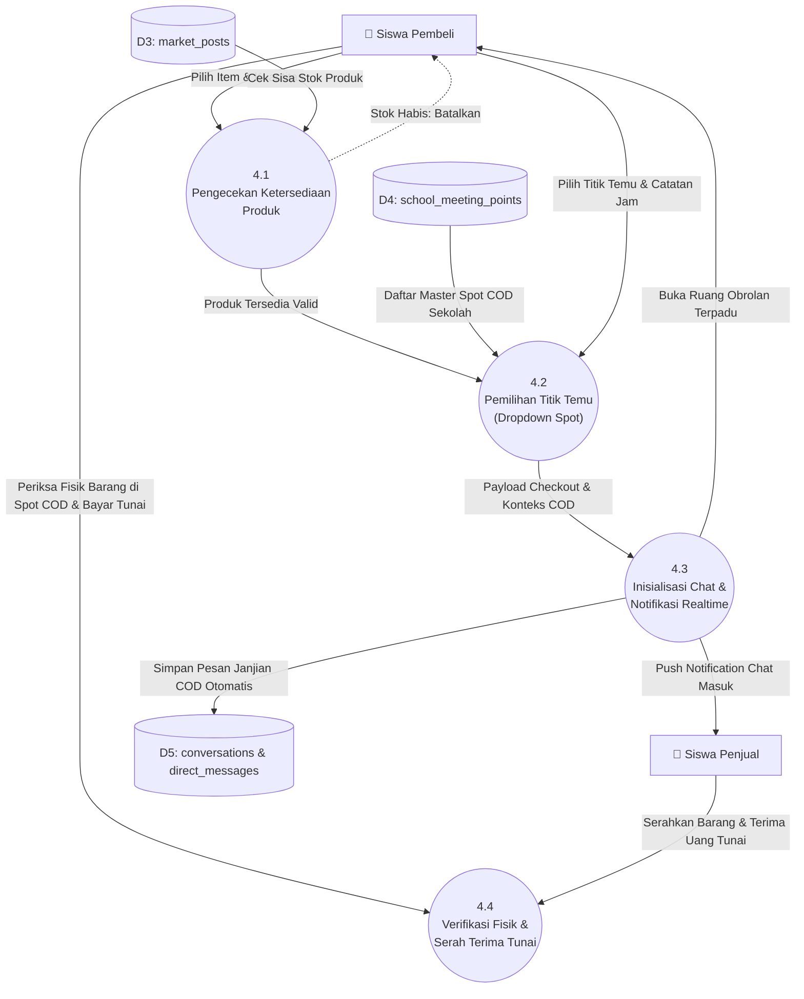

# 05. DATA FLOW DIAGRAM (DFD LEVEL 0 & LEVEL 1)

**Dokumen**: Bab III - Bagian 3.4  
**Proyek**: Snapan Market Mobile (sNaps) - SMKN 8 Semarang  
**Fokus**: Dekomposisi Fungsional Aliran Data Logis dan Interaksi Datastore  

---

## 1. Definisi Data Flow Diagram
Data Flow Diagram (DFD) memodelkan sistem dari sudut pandang pemrosesan data: bagaimana data masuk, ditransformasikan oleh proses komputasi, disimpan ke dalam *datastore*, dan dikeluarkan kembali ke entitas tujuan.

---

## 2. DFD Level 0 (Overview Sistem sNaps)

DFD Level 0 memecah *Proses 0.0* menjadi 5 sub-proses inti:

---

## 3. DFD Level 1 (Fokus: Proses 4.0 Transaksi COD & Titik Temu)

Untuk memodelkan proses koordinasi transaksi langsung di lingkungan SMKN 8 Semarang secara akurat, proses 4.0 didekomposisi lebih lanjut:

---

## 4. Matriks Hubungan Sub-Proses dengan Datastore

| Sub-Proses | Datastore Terlibat | Mode Akses | Keterangan Fungsional |
|---|---|---|---|
| **1.0 Autentikasi** | `student_registry`, `profiles` | Read, Write | Memvalidasi NIS terdaftar dan mencatat profil resmi siswa. |
| **2.0 Feed Komunitas** | `market_posts`, `profiles` | Read, Write | Menyimpan thread diskusi dan interaksi sosial. |
| **3.0 Manajemen Produk** | `market_posts` | Read, Write | Menangani CRUD etalase karya siswa dan kuantitas produk. |
| **4.0 Transaksi COD** | `conversations`, `direct_messages`, `market_posts`, `school_meeting_points` | Read, Write | Menghubungkan pembeli-penjual via chat otomatis dan titik temu sekolah. |
| **5.0 Moderasi & Admin** | `content_reports`, `student_registry`, `school_meeting_points` | Read, Write | Menjaga kepatuhan aturan sekolah dan data induk siswa. |
