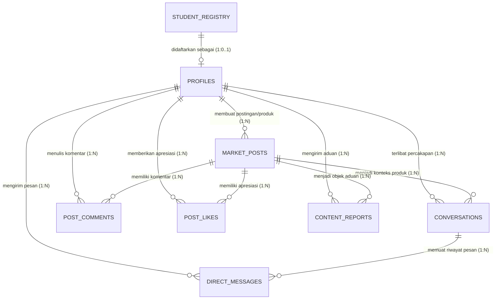

# 06. ENTITY RELATIONSHIP DIAGRAM (ERD)

**Dokumen**: Bab III - Bagian 3.6  
**Proyek**: Snapan Market Mobile (sNaps) - SMKN 8 Semarang  
**Fokus**: Pemetaan Hubungan Logis & Kardinalitas Entitas Relasional  

---

## 1. Definisi & Konsep ERD
Entity Relationship Diagram (ERD) menggambarkan struktur keterhubungan logis antar kumpulan entitas data di dalam sistem sNaps, menentukan bagaimana data siswa, produk vokasi, pesanan COD, dan titik temu sekolah saling berelasi dengan derajat kardinalitas referensial.

---

## 2. Diagram ERD Relasional sNaps

---

## 3. Kamus Entitas & Analisis Derajat Kardinalitas

### 3.1 Relasi `STUDENT_REGISTRY` ke `PROFILES` (One-to-Optional-One / `1:0..1`)
- **Partisipasi**: Setiap satu baris NIS pada `STUDENT_REGISTRY` hanya boleh didaftarkan ke maksimal **satu** akun pengguna di `PROFILES`. Siswa yang belum mendaftar aplikasi berstatus `0` akun aktif.
- **Integritas**: Menjamin asas *One Student, One Account* di lingkungan SMKN 8 Semarang untuk mencegah akun ganda (*kloningan*).

### 3.2 Relasi `PROFILES` ke `MARKET_POSTS` (One-to-Many / `1:N`)
- **Partisipasi**: Satu profil siswa dapat mempublikasikan banyak produk karya vokasi maupun thread diskusi komunitas.
- **Kunci Asing**: Kolom `seller_id` pada `MARKET_POSTS` merujuk ke `id` pada tabel `PROFILES`.

### 3.3 Relasi `PROFILES` ke `CONVERSATIONS` (One-to-Many / `1:N`)
- **Partisipasi**: Siswa dapat terlibat dalam banyak ruang obrolan (*conversations*) baik sebagai pihak pertama maupun pihak kedua.
- **Model Bisnis**: Mengadopsi koordinasi C2C (*Peer-to-Peer*) terpadu di mana siswa berinteraksi dan menyepakati transaksi COD langsung lewat ruang obrolan.

### 3.4 Relasi `MARKET_POSTS` ke `CONVERSATIONS` (One-to-Many / `1:N`)
- **Partisipasi**: Satu postingan produk karya dapat menjadi konteks pembicaraan pada banyak ruang obrolan antara calon pembeli yang berbeda dengan penjual.

### 3.5 Relasi `CONVERSATIONS` ke `DIRECT_MESSAGES` (One-to-Many / `1:N`)
- **Partisipasi**: Setiap satu ruang percakapan memuat banyak baris pesan obrolan (*direct_messages*) yang dikirimkan secara bergantian oleh kedua siswa.

### 3.6 Entitas Master `SCHOOL_MEETING_POINTS`
- **Fungsi**: Berdiri sebagai entitas data master titik kumpul resmi sekolah (seperti Gazebo PPLG, Kantin, Lobby) yang diakses siswa saat mendiskusikan janji temu COD di ruang obrolan.

---

## 4. Tabel Aturan Integritas Referensial (*Referential Actions*)

| Relasi Parent ➔ Child | Foreign Key | On Delete Rule | On Update Rule | Alasan Desain Sistem |
|---|---|---|---|---|
| `PROFILES` ➔ `MARKET_POSTS` | `seller_id` | `CASCADE` / Soft Delete | `CASCADE` | Jika profil dinonaktifkan permanen, listing ikut dinonaktifkan. |
| `PROFILES` ➔ `CONVERSATIONS` | `participant_one` / `participant_two` | `CASCADE` | `CASCADE` | Riwayat obrolan dibersihkan jika akun pengguna dihapus. |
| `MARKET_POSTS` ➔ `CONVERSATIONS` | `product_id` | `SET NULL` | `CASCADE` | Obrolan tetap bertahan meskipun postingan produk telah dihapus penjual. |
| `CONVERSATIONS` ➔ `DIRECT_MESSAGES` | `conversation_id` | `CASCADE` | `CASCADE` | Jika obrolan dihapus, seluruh isi pesan obrolan ikut terhapus. |
