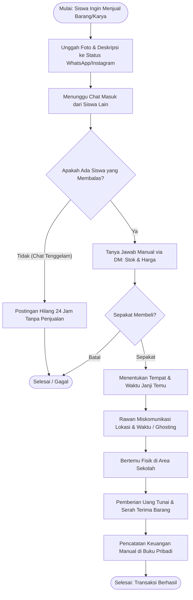
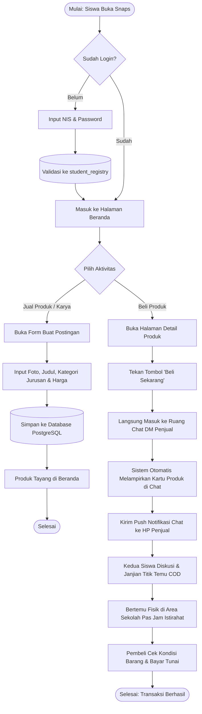
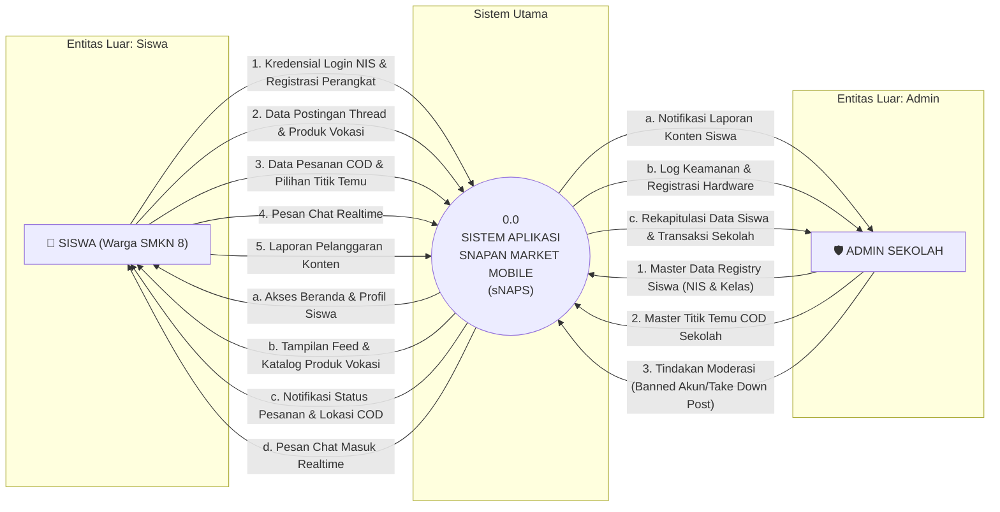
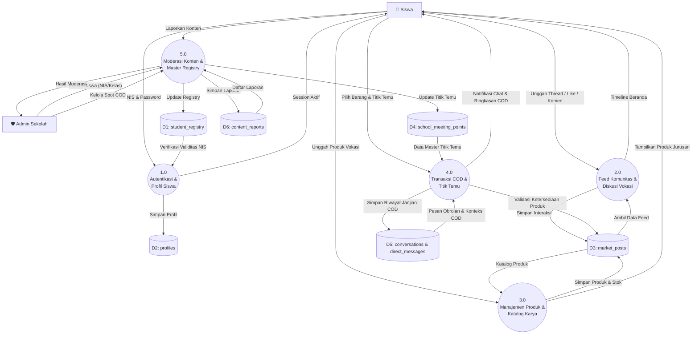
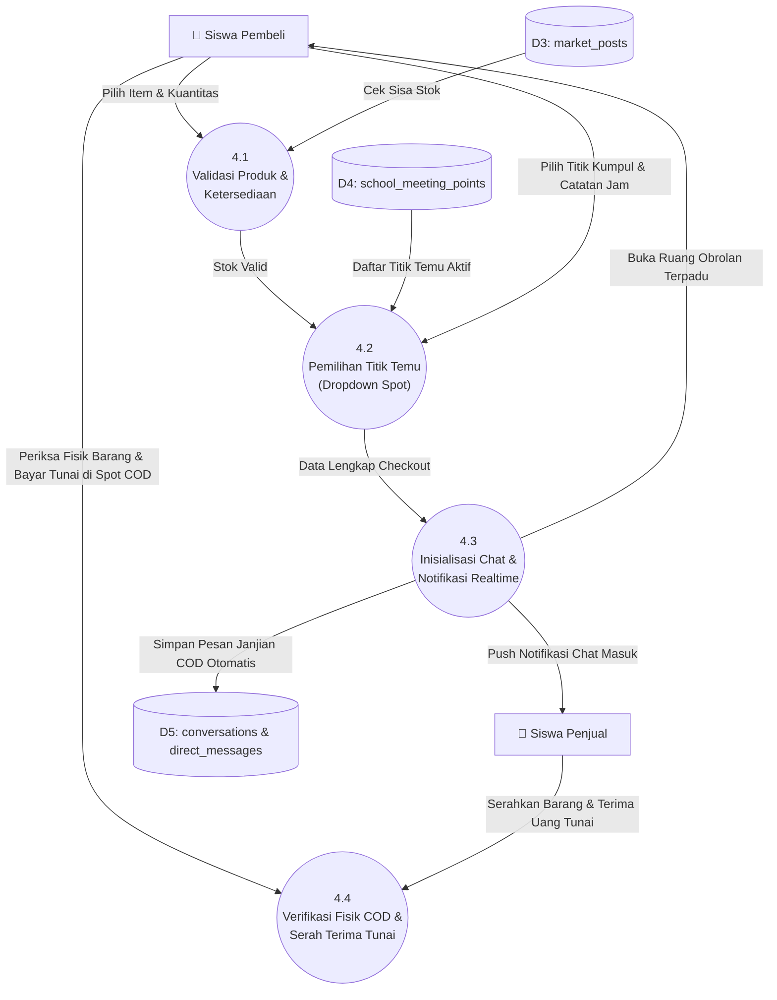
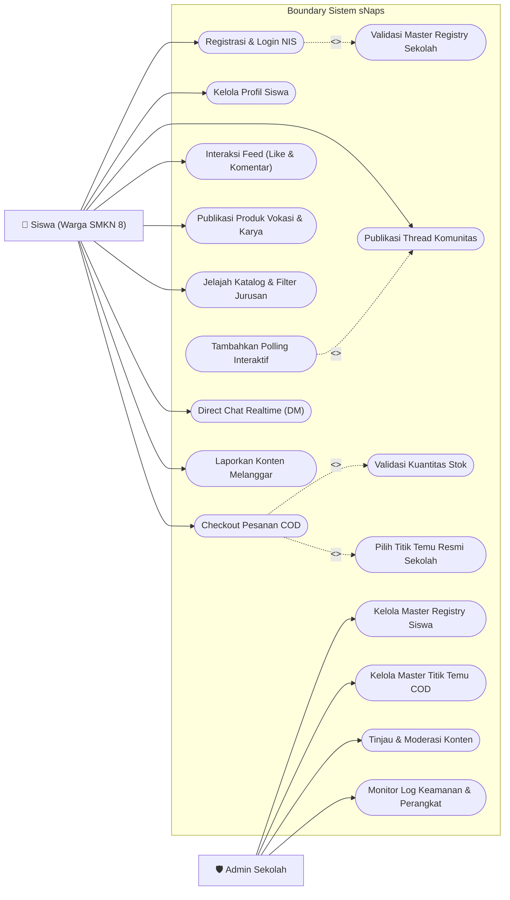
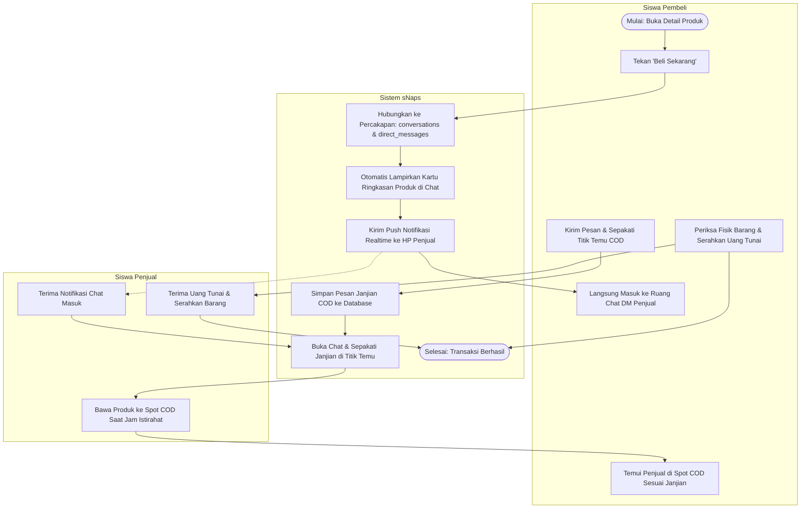
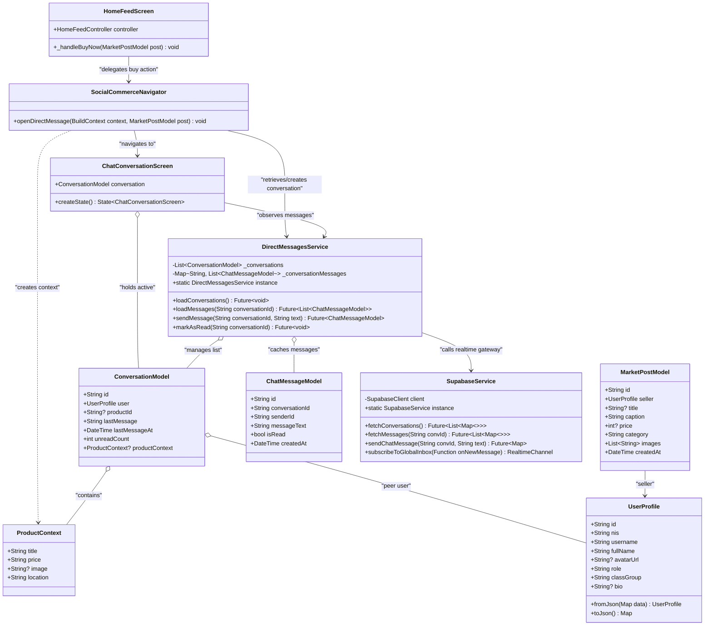
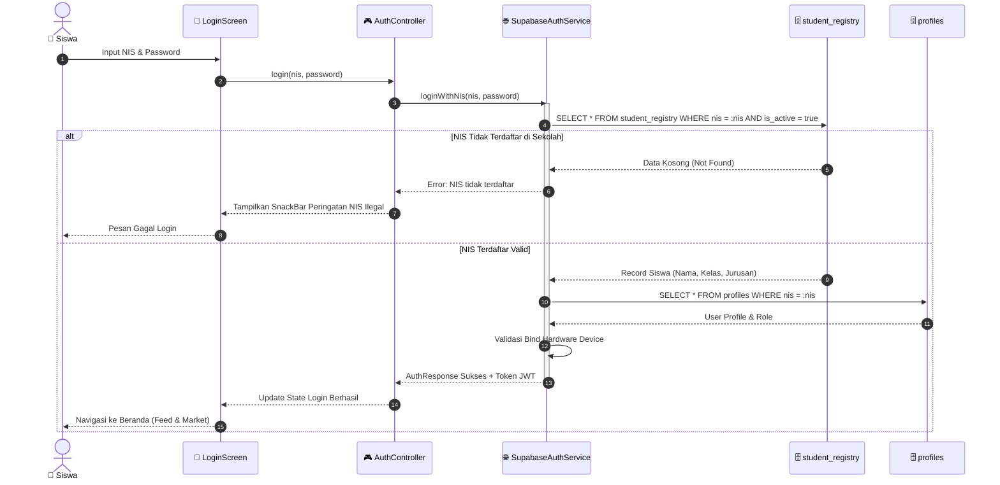
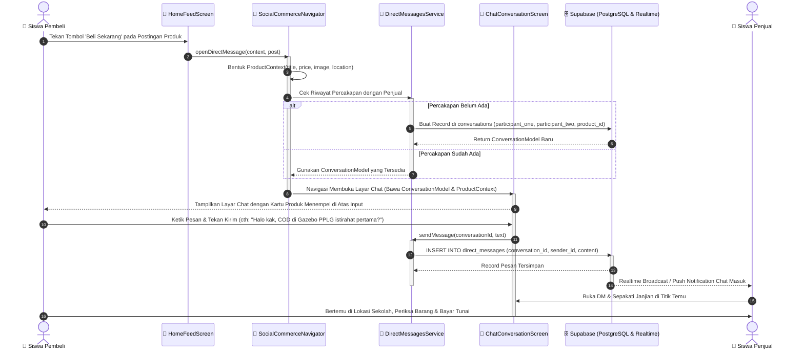

# BAB III: PERANCANGAN ARSITEKTUR SISTEM

**Judul Proyek**: Pengembangan Aplikasi Snapan Market Mobile (sNaps) Berbasis Android Sebagai Platform Komunitas dan Marketplace Vokasi di Lingkungan SMKN 8 Semarang  
**Program Keahlian**: Pengembangan Perangkat Lunak dan Gim (PPLG) - SMKN 8 Semarang  

---

## 3.1 Pelaksanaan dan Hasil Riset

### 3.1.1 Pelaksanaan Riset Lapangan
Riset perancangan sistem dilaksanakan di lingkungan kampus SMKN 8 Semarang dengan melibatkan siswa dari berbagai program keahlian (PPLG, DKV, Kuliner, dan Otomotif) melalui metode wawancara mendalam (*in-depth interview*) serta observasi langsung terhadap dinamika komunikasi siswa di grup chat WhatsApp sekolah.

### 3.1.2 Hasil dan Analisis Kebutuhan
Dari pelaksanaan riset tersebut, diperoleh kesimpulan dan analisis kebutuhan sebagai berikut:
1. **Kejenuhan dan Banjir Informasi pada Grup WhatsApp**: Siswa merasa promosi karya dan penawaran barang preloved di grup kelas atau grup angkatan sangat cepat tenggelam oleh tumpukan chat lainnya sehingga tidak efisien.
2. **Kebutuhan Wadah Unjuk Karya Jurusan**: Siswa PPLG membutuhkan media untuk mendistribusikan aplikasi/game, siswa DKV membutuhkan tempat memasarkan merchandise dan portofolio, dan siswa Kuliner memerlukan media pemesanan makanan ringan siap antar saat jam istirahat sekolah.
3. **Pentingnya Keamanan Ekosistem Berbasis NIS**: Siswa menginginkan aplikasi yang tertutup khusus warga sekolah, di mana login diwajibkan menggunakan Nomor Induk Siswa (NIS) untuk mencegah akun palsu atau penipuan dari luar sekolah.
4. **Preferensi Metode Pembayaran COD di Spot Sekolah**: Siswa menghendaki transaksi tanpa biaya admin transfer bank dengan metode pembayaran tunai saat bertemu langsung (*Cash on Delivery*) di titik-titik kumpul resmi sekolah.

---

## 3.2 Diagram Flowchart Sistem

### 3.2.1 Diagram Flowchart Alur Manual (Konvensional)
Diagram berikut menggambarkan alur jual-beli antar siswa sebelum adanya sistem aplikasi sNaps:



### 3.2.2 Diagram Flowchart Alur Sistem Digital (sNaps)
Diagram berikut menggambarkan alur terotomatisasi transaksi C2C dan interaksi komunitas pada aplikasi sNaps:



---

## 3.3 Diagram Konteks (Context Diagram)

Diagram Konteks memposisikan sistem sNaps pada Level 0 Global dengan batasan entitas luar **Siswa** dan **Admin Sekolah**:



---

## 3.4 Data Flow Diagram (DFD)

### 3.4.1 DFD Level 0
Menguraikan sistem utama menjadi lima sub-proses fungsional terintegrasi dengan tabel penyimpanan:



### 3.4.2 DFD Level 1 (Fokus: Proses 4.0 Transaksi COD)
Menguraikan rincian sub-proses koordinasi transaksi pemesanan barang hingga serah terima di sekolah:



---

## 3.5 Use Case Diagram



#### Skenario Use Case Utama (UC-07: Pemesanan Langsung via Chat DM & COD Titik Temu)
- **Aktor Utama**: Siswa Pembeli
- **Aktor Sekunder**: Siswa Penjual, Database Server
- **Kondisi Awal (Pre-condition)**: Pembeli terautentikasi NIS dan melihat karya produk di aplikasi.
- **Kondisi Akhir (Post-condition)**: Ruang percakapan `conversations` terhubung membawa konteks produk dan notifikasi terkirim ke penjual.
- **Alur Normal**: Pembeli memilih produk -> Menekan tombol 'Beli Sekarang' -> Sistem langsung menghubungkan ke ruang chat DM penjual dengan kartu ringkasan produk menempel -> Kedua siswa berdiskusi dan menyepakati titik temu COD -> Bertemu fisik saat jam istirahat untuk serah terima barang dan pembayaran tunai.
- **Alur Alternatif**: Jika penjual belum merespons, pembeli dapat meninggalkan pesan teks dan menunggu notifikasi balasan.

---

## 3.6 Activity Diagram (Pemesanan COD via Chat DM)



---

## 3.7 Perancangan Basis Data (ERD, CDM, PDM)

### 3.7.1 Conceptual Data Model (CDM)
Struktur konseptual data logis mendefinisikan hubungan bisnis antara entitas utama:
- `student_registry`: Master buku induk sekolah (NIS, Nama, Kelas, Jurusan).
- `profiles`: Akun aktif pengguna aplikasi sNaps.
- `market_posts`: Listing produk karya vokasi dan thread forum diskusi.
- `school_meeting_points`: Daftar lokasi titik temu fisik resmi di sekolah.
- `conversations` & `direct_messages`: Data obrolan privat antar pengguna terintegrasi konteks produk.
- `content_reports`: Data pelaporan konten melanggar etika sekolah.

### 3.7.2 Physical Data Model (PDM)
Struktur fisik tabel diimplementasikan pada database PostgreSQL (Supabase):

```mermaid
erDiagram
    student_registry {
        TEXT nis PK
        TEXT full_name
        TEXT class_group
        TEXT major
        BOOLEAN is_active
    }

    profiles {
        UUID id PK
        TEXT nis FK
        TEXT username
        TEXT full_name
        TEXT avatar_url
        TEXT role
        TEXT class_group
        TEXT bio
        TIMESTAMPTZ created_at
    }

    market_posts {
        UUID id PK
        UUID seller_id FK
        TEXT title
        TEXT description
        INT price
        TEXT type
        TEXT category
        JSONB image_urls
        INT view_count
        TIMESTAMPTZ created_at
    }

    school_meeting_points {
        UUID id PK
        TEXT name
        TEXT code
        TEXT area_zone
        TEXT description
        TEXT photo_url
        BOOLEAN is_active
    }

    conversations {
        UUID id PK
        UUID participant_one FK
        UUID participant_two FK
        UUID product_id FK
        TEXT last_message
        TIMESTAMPTZ last_message_at
        TIMESTAMPTZ created_at
    }

    direct_messages {
        UUID id PK
        UUID conversation_id FK
        UUID sender_id FK
        TEXT content
        BOOLEAN is_read
        TIMESTAMPTZ created_at
    }

    content_reports {
        UUID id PK
        UUID reporter_id FK
        UUID target_post_id FK
        TEXT reason
        TEXT status
        TIMESTAMPTZ created_at
    }

    student_registry ||--o| profiles : "nis"
    profiles ||--o{ market_posts : "seller_id"
    profiles ||--o{ conversations : "participant_one"
    profiles ||--o{ conversations : "participant_two"
    market_posts ||--o{ conversations : "product_id"
    conversations ||--o{ direct_messages : "conversation_id"
    profiles ||--o{ direct_messages : "sender_id"
    profiles ||--o{ content_reports : "reporter_id"
    market_posts ||--o{ content_reports : "target_post_id"
```    profiles ||--o{ content_reports : "reporter_id"
    market_posts ||--o{ content_reports : "target_post_id"
```

---

## 3.8 Class Diagram



---

## 3.9 Sequence Diagram

### 3.9.1 Sequence Diagram: Autentikasi NIS & Device Binding



### 3.9.2 Sequence Diagram: Pemesanan Langsung via Chat DM (Feed-to-DM)


