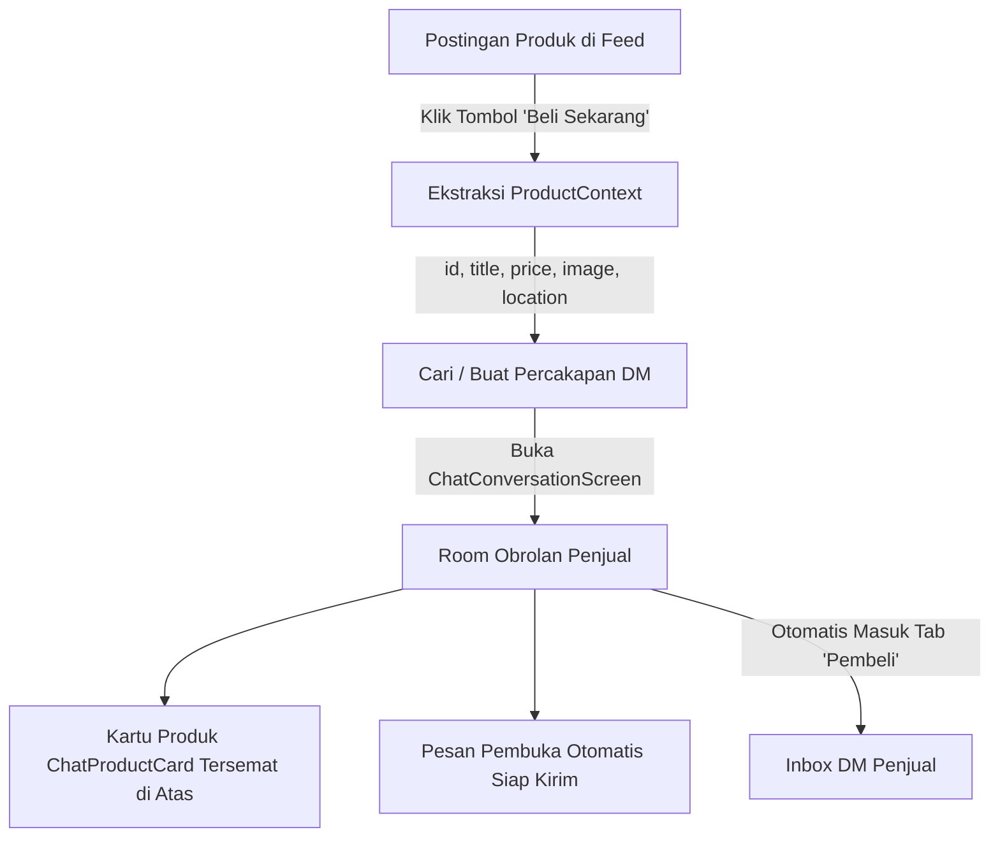

# Redesign Fitur Jualan: Social Commerce Feed ke Direct Message

> **Dokumen Spesifikasi Teknis & Pendekatan Arsitektur**
> - **Tanggal**: 2026-10-29
> - **Domain**: `feed / commerce / direct_messages / post_card / ui_redesign`
> - **Status**: Planned (Approaching)

---

## 1. Latar Belakang & Analisis Masalah

- **Kondisi Fase Beta Release**:
  Sistem jualan sebelumnya (`BuyBottomSheet`, `StickyBuyBar`, formulir checkout COD, kalkulator stok) dinonaktifkan via `AppConstants.enableCommerceMode = false` karena integrasi transaksi penuh terlalu kompleks dan rawan bug di lingkungan sekolah.
- **Kebutuhan Guru (Filter Pembeli)**:
  Perlu cara praktis untuk menyaring mana siswa yang benar-benar berniat membeli barang dan mana yang tidak (atau hanya bercanda/komentar iseng di linimasa).
- **Arah Redesign**:
  Mengadopsi pola *Social Commerce* modern (mirip iklan bersponsor / direct inquiry di Instagram dan TikTok):
  1. Feed beranda tetap satu kesatuan tanpa pemisahan tab switch atau filter chip baru.
  2. Postingan produk di linimasa memiliki tombol aksi langsung di dalam container gambar.
  3. Klik tombol langsung membuka ruang obrolan Direct Message (DM) ke penjual lengkap dengan kartu konteks produk (`ChatProductCard`).
  4. Penyaringan pembeli otomatis dilakukan di Direct Messages, di mana pesan terkait produk otomatis dikelompokkan ke dalam tab filter **"Pembeli"** di inbox penjual.

---

## 2. Spesifikasi Desain Antarmuka (UI/UX)

### A. Tombol Overlay pada Container Gambar
- **Lokasi Penempatan**: Pojok kiri bawah di dalam area gambar postingan (`Positioned(left: 12.0, bottom: 12.0)`).
- **Format Label**: Murni bertuliskan `Beli Sekarang` diikuti ikon panah kanan (Right Icon, e.g. `Icons.arrow_forward_rounded` atau chevron). Tidak menyertakan nominal harga di dalam teks tombol.
- **Visual Styling**:
  - Tipe container: Pill / squircle dengan background gelap semi-transparan (glassmorphism/blur atau dark elevated surface) berkontras tinggi agar selalu terbaca jelas di atas warna gambar apa pun.
  - Tipografi: Font berukuran 12–13sp, font weight semi-bold (W600), warna teks putih dengan jarak ikon seimbang (4–6dp).
  - Micro-interaction: Haptic feedback saat ditekan (`HapticFeedback.lightImpact`).

### B. Isolasi Gesture (Mencegah Konflik Tap)
- **Tap pada Tombol `Beli Sekarang`**:
  Menghentikan propagasi gesture (`HitTestBehavior.opaque`), tidak memicu zoom/lightbox, melainkan langsung membuka halaman Direct Message ke penjual.
- **Tap di Area Gambar Lainnya**:
  Tetap membuka `MediaLightboxDialog` layar penuh agar calon pembeli tetap leluasa memeriksa detail dan kondisi fisik barang dagangan.

---

## 3. Alur Navigasi & Integrasi Data (Feed -> DM)

### Rincian Alur:
1. **Pengambilan Metadata Produk**:
   Saat tombol ditekan, ambil konteks dari `MarketPostModel`:
   - `productId`: ID postingan produk.
   - `title`: Judul produk atau ringkasan baris pertama caption.
   - `price`: Nominal harga yang diformat (misal `Rp 25.000`).
   - `image`: URL foto pertama produk.
   - `location`: Lokasi spot COD kampus (`locationTag`).
2. **Inisiasi Percakapan**:
   Panggil `DirectMessagesService` untuk membuka atau membuat percakapan dengan `seller.id` dan menyematkan `productId`.
3. **Penyaringan Otomatis di Inbox Penjual**:
   Karena percakapan memiliki `productId`, model percakapan otomatis tervalidasi dengan `isRequest = true`. Di layar inbox pesan penjual (`DirectMessagesScreen`), obrolan ini langsung tersaring ke tab **"Pembeli"**, terpisah dari obrolan teman biasa.

---

## 4. Cakupan File Target (Target File Scope)

| Path File | Tanggung Jawab & Rencana Perubahan |
| :--- | :--- |
| `lib/features/feed/components/post_card/post_media_section.dart` | Tambahkan overlay widget tombol `Beli Sekarang` (dengan right icon) di pojok kiri bawah container gambar jika post bertipe produk |
| `lib/features/feed/components/post_card/post_card_content_column.dart` | Teruskan event callback `onBuyNowClick` dari media section ke parent post card |
| `lib/features/feed/components/post_card/market_post_card.dart` | Sediakan properti callback `onBuyNowClick` untuk dikonsumsi oleh controller feed |
| `lib/features/feed/screens/home_feed_screen.dart` | Implementasikan handler navigasi: susun `ProductContext`, panggil `DirectMessagesService`, dan dorong `ChatConversationScreen` |
| `lib/features/messages/screens/chat_conversation_screen.dart` | Pastikan `ChatProductCard` ter-render rapi dan context produk terpasang di room chat |

---

## 5. Kriteria Selesai (Definition of Done)

- [ ] Pada postingan jualan/produk di feed, muncul tombol overlay bertuliskan `Beli Sekarang` dengan ikon panah kanan di pojok kiri bawah container gambar.
- [ ] Tombol `Beli Sekarang` memiliki kontras visual yang jelas dan nyaman dibaca di atas gambar apa pun.
- [ ] Menekan tombol `Beli Sekarang` langsung membuka layar obrolan Direct Message dengan penjual.
- [ ] Di dalam ruang chat, tersemat kartu konteks produk (`ChatProductCard`) yang memuat foto, judul, harga, dan lokasi COD.
- [ ] Menekan area gambar di luar tombol `Beli Sekarang` tetap membuka Media Lightbox untuk zoom/preview gambar.
- [ ] Obrolan yang terbentuk otomatis tersaring ke dalam tab filter "Pembeli" pada inbox Direct Messages penjual.
- [ ] Feed linimasa tetap bersih tanpa perubahan tata letak tab atau filter chip yang tidak diperlukan.
